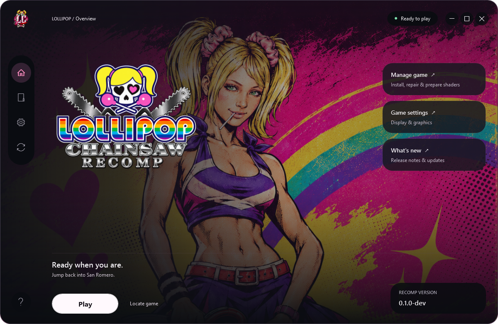
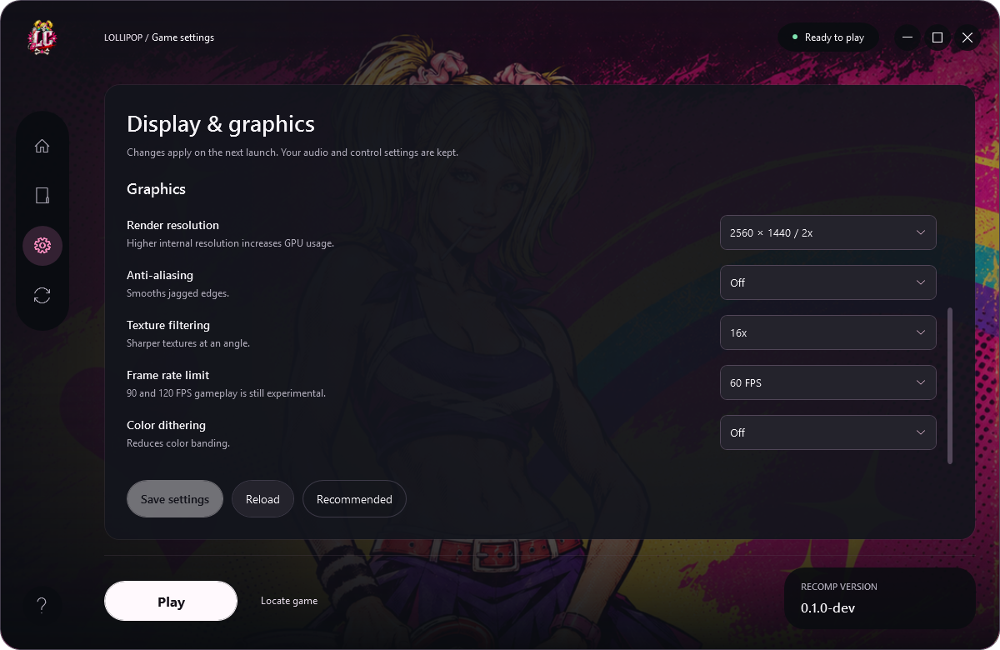
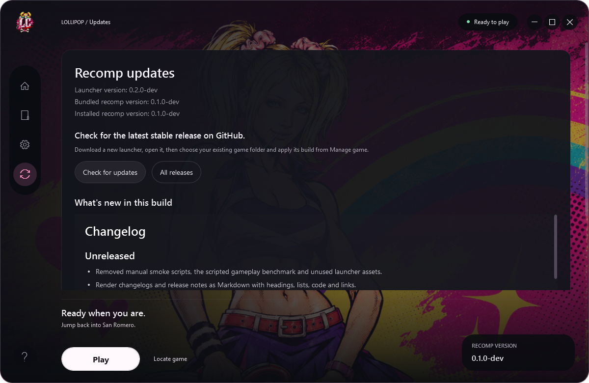

# Lollipop Chainsaw Recomp

  

The original Xbox 360 game, recompiled for Windows. Requires your own game copy;
game files are not included.

## Getting started

Download the [latest launcher](https://github.com/kxrxh/lollipop-chainsaw-recomp/releases/latest)
and run it. Requires Windows x64, internet for setup, and an ISO of the
[supported Xbox 360 disc](docs/BUILDING.md#supported-game).

## Launcher

Graphics settings and updates

## Known issues

Earlier loading/cutscene stalls and D3D12 crashes were not reproduced in current
targeted checks. A full playthrough, including the natural third-rescue phone
transition, remains unverified.
See [compatibility and troubleshooting](docs/COMPATIBILITY.md).

## Docs

[Build from source (optional)](docs/BUILDING.md) ·
[Update / repair](docs/BUILDING.md#updating-or-removing-an-installation) ·
[Development](docs/DEVELOPMENT.md) · [Changelog](CHANGELOG.md)

## Credits

By [kxrxh](https://github.com/kxrxh). Built with
[ReXGlue](https://github.com/rexglue/rexglue-sdk) and Xenia.
[BSD-3-Clause](LICENSE) · [Credits and artwork notices](THIRD_PARTY.md).
